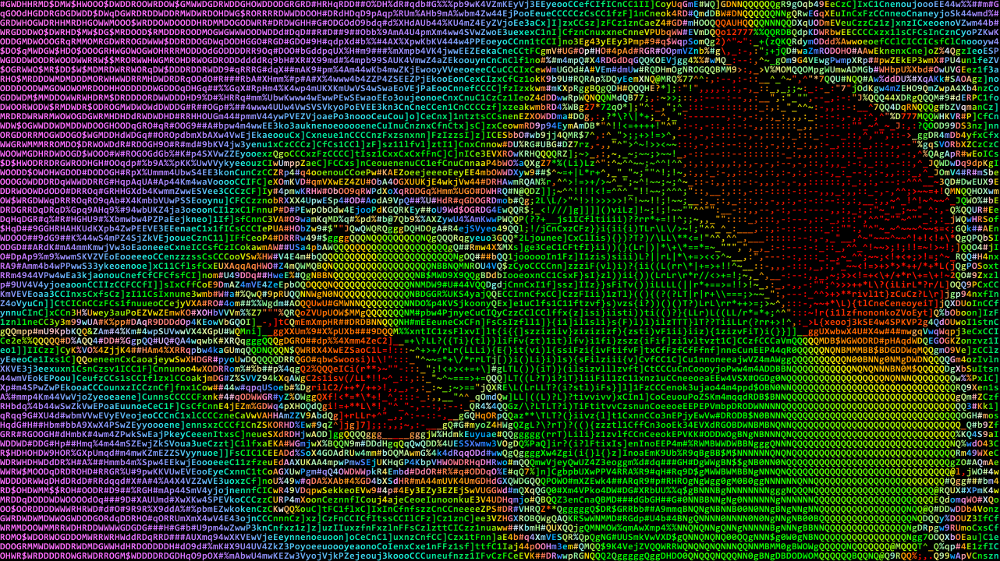

# Video-Code

Play any video as live, full-colour ASCII art in a desktop window, or export it to a new video file.



- **Fast**: written in Rust and spread across every CPU core. Plays 60 fps video with over 100,000 characters per frame.
- **Sharp**: shape-matched characters follow edges (`/ | - _`), and a dithered brightness ramp fills flat areas with that busy "wall of code" texture.
- **Colour**: every character takes the colour of the video underneath it. Five colour styles to switch between.
- **Sound**: audio plays in sync and is the clock the video follows.
- **Export**: render the ASCII version to `.mp4` (with the original sound) or a single frame to `.png`.

## Requirements

- [Rust](https://rustup.rs)
- [FFmpeg](https://ffmpeg.org) on your `PATH` (Windows: `winget install Gyan.FFmpeg`, macOS: `brew install ffmpeg`, Linux: your package manager)

## Run it

```sh
cargo run --release -- path/to/video.mp4
```

Or build it once and use the program directly:

```sh
cargo build --release
./target/release/video-code path/to/video.mp4
```

Start it without a file and you get an animated idle screen. Drag a video onto the window to play it.

### Controls

| Key | Action |
| --- | --- |
| `Space` | pause / play |
| `←` `→` | seek 5 seconds |
| `0`–`9` | jump to 0%–90% |
| click bottom edge | seek to that point |
| `+` `-` / mouse wheel | bigger / smaller characters (less / more detail) |
| `c` | colour style: color → color-bg → matrix → amber → mono |
| `s` | character style: hybrid → shape → ramp |
| `[` `]` | softer / sharper edges |
| `,` `.` | darker / brighter |
| `↑` `↓` | volume |
| `m` | mute |
| `l` | loop |
| `f` / `F11` | fullscreen |
| `h` | keep the stats overlay on screen |
| `q` / `Esc` | quit |

### Export

```sh
# The whole video, ASCII-fied, with its sound
video-code clip.mp4 -o ascii.mp4

# 15 seconds starting at 1:00, 1080 px on the long side, green terminal style
video-code clip.mp4 --start 60 -t 15 --size 1080 -c matrix -o tiktok.mp4

# One frame as an image
video-code clip.mp4 --start 12.5 -o frame.png
```

### Useful options

| Option | What it does |
| --- | --- |
| `-s, --font-size <PX>` | Character height. Smaller means more detail (default 12) |
| `-c, --color <MODE>` | `color`, `color-bg`, `matrix`, `amber`, `mono` |
| `--style <STYLE>` | `hybrid` (default), `shape`, `ramp` |
| `--charset <CHARS>` | Draw with your own characters, e.g. `" .:-=+*#%@"` or `" ░▒▓█"` |
| `--font <FILE>` | Any monospace `.ttf`/`.otf` |
| `--brightness`, `--saturation`, `--contrast` | Tune the look |
| `-l, --loop` | Loop forever |
| `--no-hwaccel` | Decode on the CPU instead of the GPU |

Run `video-code --help` for everything.

## How it works

1. **Decode.** `ffmpeg` decodes the video into raw RGB frames at a fixed frame rate on a background thread. A second `ffmpeg` decodes the audio.
2. **Measure.** The picture is split into a grid of character cells. Each cell is split again into 6 zones (2 × 3), and the program measures the brightness of each zone and the cell's average colour.
3. **Pick a character.** At startup, every character of the font is rasterised and measured the same way, so each one gets a 6-number "shape". Cells with an edge in them get the character whose shape is closest (so a diagonal edge becomes `/`). Flat cells get a character by brightness from a ramp sorted by ink coverage, with a little fixed noise so gradients mix neighbouring characters.
4. **Colour and draw.** Each character is drawn in the cell's colour, pushed towards full brightness because the character's ink already shows how bright the cell is. All of this runs in parallel with `rayon`, straight into the window's pixel buffer (`winit` + `softbuffer`).
5. **Sync.** The number of audio samples the sound card has played is the playback clock. Each video frame is shown when its timestamp comes up, and late frames are dropped.

| File | Role |
| --- | --- |
| `src/probe.rs` | reads size, frame rate and duration with ffprobe |
| `src/decode.rs` | video decoding thread |
| `src/audio.rs` | audio decoding and output (cpal), playback clock |
| `src/font.rs` | glyph rasterising and shape measurement |
| `src/ascii.rs` | frame → characters + colours |
| `src/render.rs` | characters → pixels, on-screen text |
| `src/player.rs` | the window, controls, HUD |
| `src/export.rs` | rendering to a file |
